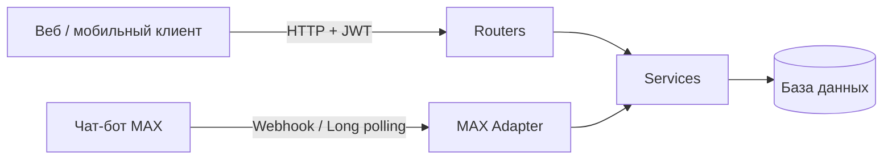

# TaskFlow API

Бэкенд для управления задачами с JWT-авторизацией и интеграцией мессенджеров.
Один API обслуживает и HTTP-клиентов (веб/мобилка), и чат-бота в мессенджере MAX.

## Возможности

- Регистрация и вход по OAuth2 Password Flow, JWT-токены
- CRUD задач с пагинацией и фильтром по статусу
- **Изоляция данных**: пользователь видит и меняет только свои задачи
- Чат-бот MAX: создание и просмотр задач прямо из мессенджера
- Привязка аккаунта мессенджера к пользователю — бот помнит вас после перезапуска
- Асинхронная работа с БД (SQLAlchemy 2.0 async), миграции Alembic
- Автоматические тесты (pytest)

## Стек

| Слой | Технология |
|------|-----------|
| API | FastAPI, Pydantic v2 |
| БД | SQLAlchemy 2.0 (async) + SQLite (dev) / PostgreSQL (prod) |
| Миграции | Alembic |
| Авторизация | python-jose (JWT), passlib + bcrypt |
| Конфиг | pydantic-settings (.env) |
| HTTP-клиент | httpx |
| Тесты | pytest, pytest-asyncio |

## Архитектура



**Принципы:**

- **Роутеры тонкие** — только HTTP-логика: валидация, статусы, зависимости. Никаких запросов к БД.
- **Сервисный слой** — вся бизнес-логика и работа с БД (`app/services`).
- **Боты — внутренние адаптеры.** Они вызывают сервисы напрямую, а `owner_id` берут из таблицы `messenger_links`. JWT им не нужен: токен не истекает каждые 30 минут, пользователь не вводит его вручную.
- **Общий обработчик команд** (`messenger.py`) не знает, из какого мессенджера пришло сообщение. Добавить новую платформу = написать один адаптер.

## Структура проекта

```
app/
  core/config.py          # настройки из .env
  db/                     # engine, сессии, Base
  models/models.py        # User, Task, MessengerLink
  schemas/schemas.py      # Pydantic-схемы
  security/security.py    # хеширование паролей, JWT
  routers/                # auth, tasks, max_bot
  services/               # users, tasks, links, messenger, max_client, max_handlers
alembic/                  # миграции
tests/                    # pytest
emulate_max_update.py     # эмулятор событий MAX (без токена и сети)
run_max_polling.py        # MAX long polling для разработки
check_db.py               # инспекция БД
```

## Быстрый старт

Требуется Python 3.12+.

```bash
# 1. Клонировать и создать окружение
git clone https://github.com/TriggerHappyTim/taskflow_api.git
cd taskflow_api
python -m venv venv

# 2. Активировать
# Windows (PowerShell):
.\venv\Scripts\Activate.ps1
# Windows (CMD):
venv\Scripts\activate.bat
# macOS / Linux:
source venv/bin/activate

# 3. Установить зависимости
python -m pip install -r requirements.txt

# 4. Настроить окружение
cp .env.example .env        # Windows: copy .env.example .env
# Сгенерировать SECRET_KEY и вписать в .env:
python -c "import secrets; print(secrets.token_hex(32))"

# 5. Применить миграции
python -m alembic upgrade head

# 6. Запустить
python -m uvicorn app.main:app --reload
```

Документация: **http://127.0.0.1:8000/docs** (Swagger UI) и `/redoc`.

## Переменные окружения

| Переменная | Назначение |
|-----------|-----------|
| `DATABASE_URL` | строка подключения к БД |
| `SECRET_KEY` | ключ подписи JWT (обязательно свой!) |
| `ACCESS_TOKEN_EXPIRE_MINUTES` | время жизни токена |
| `MAX_BOT_TOKEN` | токен бота MAX |
| `MAX_API_URL` | `https://platform-api2.max.ru` |
| `MAX_WEBHOOK_SECRET` | секрет для проверки входящих вебхуков |

Секреты хранятся только в `.env` (файл в `.gitignore`). Шаблон — `.env.example`.

## API

| Метод | Путь | Описание | Auth |
|-------|------|----------|------|
| POST | `/auth/register` | регистрация | — |
| POST | `/auth/login` | вход, выдача JWT (form-data) | — |
| GET | `/auth/me` | текущий пользователь | JWT |
| POST | `/tasks/` | создать задачу | JWT |
| GET | `/tasks/` | список своих задач (пагинация, фильтр) | JWT |
| GET | `/tasks/{id}` | получить задачу | JWT |
| PATCH | `/tasks/{id}` | обновить задачу | JWT |
| DELETE | `/tasks/{id}` | удалить задачу | JWT |
| POST | `/webhooks/max` | приём событий от MAX | secret |
| GET | `/health` | проверка работоспособности | — |

`owner_id` не передаётся клиентом — он определяется из JWT. Попытка обратиться к чужой задаче возвращает `404`.

## Чат-бот MAX

Команды бота:

```
/login <логин> <пароль>   — привязать аккаунт TaskFlow
/task <название>          — создать задачу
/tasks [N]                — список задач (страница N)
/done <id>                — отметить выполненной
/del <id>                 — удалить задачу
/logout                   — отвязать аккаунт
/help                     — справка
```

### Проверка без токена и без интернета

```bash
python emulate_max_update.py
```

Скрипт генерирует события в реальном формате платформы MAX и прогоняет их через
адаптер → общий обработчик → сервисы → ту же БД, что использует API.
Созданные задачи видны в Swagger под пользователем `demo`.

### Подключение реального бота

1. Зарегистрируйтесь на [платформе MAX для партнёров](https://dev.max.ru) и верифицируйте профиль (юрлицо, ИП или самозанятый).
2. Создайте бота, дождитесь модерации, скопируйте токен: **Чат-боты → ⋮ → Настройки**.
3. Впишите `MAX_BOT_TOKEN` в `.env`.
4. Для разработки запустите long polling (публичный URL не нужен):
   ```bash
   python run_max_polling.py
   ```
5. Для продакшена зарегистрируйте HTTPS-вебхук через `POST /subscriptions`.

Особенности платформы, учтённые в коде:
- базовый URL `https://platform-api2.max.ru`, авторизация заголовком `Authorization: <token>`
- получатель сообщения передаётся в query (`chat_id` / `user_id`), тело — `{text, format}`
- курсор long polling — поле `marker` из ответа, а не id события
- ошибки могут приходить с HTTP 200 и `success: false` — проверяются и код, и тело
- лимиты: 30 rps, не более 2 сообщений в секунду в один чат

## Тесты

```bash
python -m pytest -q
```

Покрыто: регистрация и вход, защита эндпоинтов, изоляция задач между пользователями,
пагинация, логика команд бота, разбор реального формата событий MAX.

## Особенности окружения

- **bcrypt зафиксирован на 4.0.1** — более новые версии несовместимы с passlib.
- **Python 3.14 + SQLAlchemy**: в `Mapped[...]` нельзя использовать `str | None`; nullable-поля описываются как `mapped_column(Text, nullable=True)`.
- **Windows**: команды запускаются через `python -m ...